# Cropsey lab

Home lab on 192.168.1.x: Rocky Linux VMs on Hyper-V, Raspberry Pi 5s, k3s and microk8s, an observability stack,
API-security labs, and AI agents that run on a local LLM through LiteLLM.

## What's running (updated daily)

The map below is regenerated every morning at 05:40 by
[servicemap-agent](https://github.com/mcropsey/mikes-agents/tree/main/servicemap-agent). It logs into every host
Grafana monitors and inventories systemd services, timers, cron jobs, podman/docker containers, Kubernetes workloads
and AI agents. Changes are committed to [`service-map/`](service-map/), so that folder's history is the lab's change log.

<picture>
  <source media="(prefers-color-scheme: dark)" srcset="service-map/fleet-dark.svg">
  
</picture>

### AI agents and their dependencies

<picture>
  <source media="(prefers-color-scheme: dark)" srcset="service-map/ai-map-dark.svg">
  
</picture>

Solid arrows are live connections seen at collection time; dashed arrows are endpoints configured in each service.

## In this repo

| Path | What it is |
|---|---|
| [`service-map/`](service-map/) | The daily map: [`README.md`](service-map/README.md) (changes, mermaid diagram, per-host tables), `index.html` (interactive version, open locally), `servicemap.json` (data), SVG images. Generated; don't edit by hand. |
| [`lab-inventory.md`](lab-inventory.md) | Hand-maintained inventory: every host, service, port, runbook note and the change log. |
| [`archive/`](archive/) | Earlier diagrams. |

## Related

- [mikes-agents](https://github.com/mcropsey/mikes-agents): the scheduled lab agents (secnews, labwatch, cvewatch,
  patchwatch, labinventory, servicemap) and agenthub, the exporter that puts their reports into Grafana.
- On the lab network only: live map `http://192.168.1.98:9440/`, all agent reports `http://192.168.1.98:9440/reports/`,
  Grafana dashboards *Lab Service Map* and *Agent Lab · Daily Reports* on `http://192.168.1.98:3000`.
