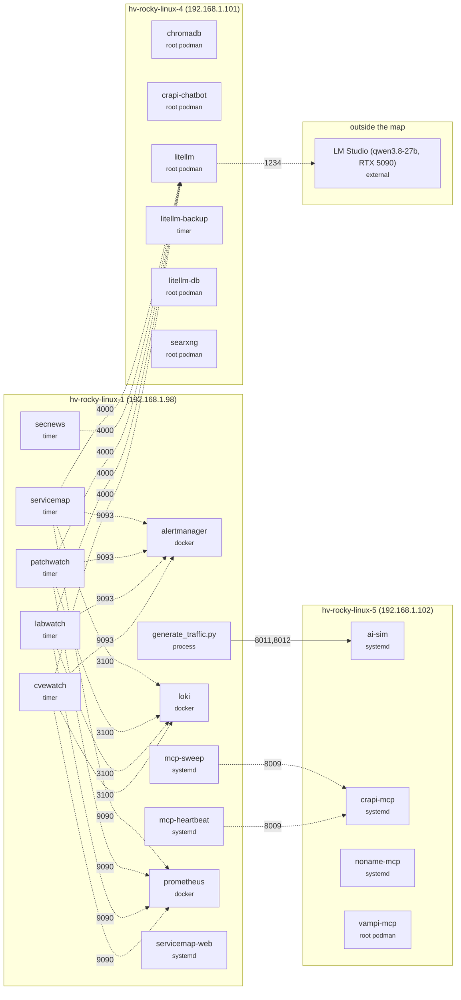

# Lab service map

Generated **2026-10-15 05:40** (America/Chicago) by [servicemap-agent](https://github.com/mcropsey/mikes-agents/tree/main/servicemap-agent) on .98. Live page (in Grafana and on the lab network): `http://192.168.1.98:9440/`. Open [`index.html`](index.html) locally for the interactive version.

## Changes since the previous map

No changes.

## AI agents & dependencies

Solid arrows: live connections seen at collection time. Dotted: configured in the service environment.

## Hosts

| Host | Role | Services | Scheduled | Containers | k8s | Notable components |
|---|---|---|---|---|---|---|
| **rk1** `192.168.1.75` | Raspberry Pi 5 microk8s node running nginx ingress, vampi | 7 | 1 | 0 | 2 | alloy, node_exporter, nginx-ingress-microk8s-controller, scheduled-reboot, microk8s (snap) ×5, vampi |
| **rk2** `192.168.1.76` | Raspberry Pi 5 microk8s node running nginx ingress, vampi | 7 | 1 | 0 | 2 | alloy, node_exporter, nginx-ingress-microk8s-controller, scheduled-reboot, microk8s (snap) ×5, vampi |
| **rasp5** `192.168.1.85` | Raspberry Pi 5 control node with Docker, Apache, Twingate | 6 | 1 | 1 | 0 | alloy, glances, node_exporter, apache2, twingate-jade-limpet, scheduled-reboot, containerd, docker |
| **hv-rocky-linux-1** `192.168.1.98` | observability hub with Prometheus, Grafana, Loki, Alertmanager, VulnNotes | 8 | 6 | 7 | 0 | 🤖 cvewatch, 🤖 generate_traffic.py ×2, 🤖 labwatch, 🤖 mcp-heartbeat, 🤖 mcp-sweep, 🤖 patchwatch, 🤖 secnews, 🤖 servicemap, agenthub, alloy, monitoring stack ×5, node_exporter, 🤖 servicemap-web, vnotes, vulnnotes, labinventory, containerd, docker |
| **hv-rocky-linux-2** `192.168.1.99` | k3s cluster with Cloudflare tunnel, nginx, Juice Shop, vampi | 4 | 0 | 0 | 4 | alloy, node_exporter, vampi, cloudflared, ingress-nginx-controller, nginx, k3s, juice-shop |
| **hv-rocky-linux-3** `192.168.1.100` | Kong gateway hosting Jenkins CI and Docker | 5 | 0 | 4 | 0 | alloy, cadvisor, node_exporter, prometheus-podman-exporter, kong, jenkins, jenkins-docker, containerd, docker |
| **hv-rocky-linux-4** `192.168.1.101` | LiteLLM gateway with crAPI, Juice Shop, Noname sensor | 4 | 1 | 15 | 0 | 🤖 litellm, 🤖 searxng, alloy, node_exporter, prometheus-podman-exporter, noname-sensor, 🤖 litellm-backup, 🤖 litellm-db, 🤖 crapi stack ×10, dvga, juice-shop |
| **hv-rocky-linux-5** `192.168.1.102` | Noname sensor running crAPI, Noname, vampi MCP, AI sim | 7 | 0 | 1 | 0 | 🤖 ai-sim, 🤖 crapi-mcp, 🤖 noname-mcp, 🤖 vampi-mcp, alloy, node_exporter, prometheus-podman-exporter, noname-sensor |
| **hv-rocky-linux-6** `192.168.1.103` | RHCSA practice workstation | 2 | 0 | 0 | 0 | alloy, node_exporter |
| **hv-rocky-linux-7** `192.168.1.104` | RHCSA practice workstation | 3 | 0 | 0 | 0 | alloy, node_exporter, prometheus-podman-exporter |
| **utility.lab** `192.168.1.105` | RHCSA utility server with dnf mirror, DNS, NFS | 5 | 0 | 0 | 0 | alloy, node_exporter, dnsmasq, httpd, nfs-mountd |

## AI components

| Component | Host | Runtime | Category | Purpose | Schedule / ports |
|---|---|---|---|---|---|
| cvewatch | hv-rocky-linux-1 | timer | AI agents | Matches CVEs to lab software. | *-*-* 06:30:00 America/Chicago |
| generate_traffic.py | hv-rocky-linux-1 | process | AI agents | Long-running AI traffic simulator on hv-rocky-linux-1. |  |
| labwatch | hv-rocky-linux-1 | timer | AI agents | Generates lab health briefings. | *-*-* 06:15:00 America/Chicago |
| mcp-heartbeat | hv-rocky-linux-1 | systemd | AI agents | Keeps Noname MCP session alive. |  |
| mcp-sweep | hv-rocky-linux-1 | systemd | AI agents | Runs read-only MCP sweeps. |  |
| patchwatch | hv-rocky-linux-1 | timer | AI agents | Plans weekly patch and image drift. | Mon *-*-* 06:45:00 America/Chicago |
| secnews | hv-rocky-linux-1 | timer | AI agents | Creates daily cybersecurity news digest. | *-*-* 06:00:00 America/Chicago |
| servicemap | hv-rocky-linux-1 | timer | AI agents | Daily SSH inventory and LLM labeling for lab service map | *-*-* 05:40:00 America/Chicago |
| ai-sim | hv-rocky-linux-5 | systemd | AI agents | AI traffic simulator for sensor discovery |  |
| chromadb | hv-rocky-linux-4 | root podman | AI platform | Vector database for AI embeddings |  |
| litellm | hv-rocky-linux-4 | root podman | AI platform | LiteLLM gateway for LLM API access | 4000->4000/tcp |
| searxng | hv-rocky-linux-4 | root podman | AI platform | Web search backend for AI agents | 8080->8080/tcp |
| crapi-mcp | hv-rocky-linux-5 | systemd | AI platform | crAPI MCP server exposing lab API tools |  |
| noname-mcp | hv-rocky-linux-5 | systemd | AI platform | Noname management API MCP server |  |
| vampi-mcp | hv-rocky-linux-5 | root podman | AI platform | VAmPI MCP server for AI tool access | 5000->5000/tcp |
| LM Studio (qwen3.8-27b, RTX 5090) |  | external | AI platform | Local LLM model server for lab AI work |  |
| servicemap-web | hv-rocky-linux-1 | systemd | Observability | Web server for LLM-labeled lab service map reports |  |
| litellm-backup | hv-rocky-linux-4 | timer | Ops & CI | Nightly backup of LiteLLM database and config | *-*-* 02:30:00 |
| litellm-db | hv-rocky-linux-4 | root podman | Platform & data | PostgreSQL database for LiteLLM gateway |  |
| crapi-chatbot | hv-rocky-linux-4 | root podman | Lab target apps | crAPI chatbot service using LLM | 5500->5500/tcp |

## Every component

<b>rk1</b> (192.168.1.75): 10 components

| Component | Runtime | Category | Purpose | State | Schedule / ports | Image / program |
|---|---|---|---|---|---|---|
| alloy | systemd | Observability | Collects OpenTelemetry telemetry for lab monitoring | running |  | `/usr/bin/alloy run` |
| node_exporter | systemd | Observability | Exports host metrics for Prometheus | running |  | `/usr/local/bin/node_exporter` |
| nginx-ingress-microk8s-controller | k8s | Network & ingress | Ingress controller for MicroK8s traffic | running |  | `registry.k8s.io/ingress-nginx/controller:v1.11.5` |
| scheduled-reboot | timer | Ops & CI | Guarded daily reboot maintenance job | inactive | *-*-* 03:00:00 | `/usr/local/sbin/safe-reboot.sh` |
| snap.microk8s.daemon-apiserver-kicker | systemd | Platform & data | Supports microk8s API server on rk2 | running |  | `/usr/bin/snap run` |
| snap.microk8s.daemon-cluster-agent | systemd | Platform & data | Runs microk8s cluster agent on rk2 | running |  | `/usr/bin/snap run` |
| snap.microk8s.daemon-containerd | systemd | Platform & data | Runs containers for microk8s on rk2 | running |  | `/usr/bin/snap run` |
| snap.microk8s.daemon-k8s-dqlite | systemd | Platform & data | Stores microk8s cluster state on rk2 | running |  | `/usr/bin/snap run` |
| snap.microk8s.daemon-kubelite | systemd | Platform & data | Manages microk8s node workload on rk2 | running |  | `/usr/bin/snap run` |
| vampi | k8s | Lab target apps | Vulnerable API demo application | running |  | `erev0s/vampi:latest` |

<b>rk2</b> (192.168.1.76): 10 components

| Component | Runtime | Category | Purpose | State | Schedule / ports | Image / program |
|---|---|---|---|---|---|---|
| alloy | systemd | Observability | Collects OpenTelemetry telemetry for lab monitoring | running |  | `/usr/bin/alloy run` |
| node_exporter | systemd | Observability | Exports host metrics for Prometheus | running |  | `/usr/local/bin/node_exporter` |
| nginx-ingress-microk8s-controller | k8s | Network & ingress | Ingress controller for MicroK8s traffic | running |  | `registry.k8s.io/ingress-nginx/controller:v1.11.5` |
| scheduled-reboot | timer | Ops & CI | Guarded daily reboot maintenance job | inactive | *-*-* 03:15:00 | `/usr/local/sbin/safe-reboot.sh` |
| snap.microk8s.daemon-apiserver-kicker | systemd | Platform & data | Supports microk8s API server on rk2 | running |  | `/usr/bin/snap run` |
| snap.microk8s.daemon-cluster-agent | systemd | Platform & data | Runs microk8s cluster agent on rk2 | running |  | `/usr/bin/snap run` |
| snap.microk8s.daemon-containerd | systemd | Platform & data | Runs containers for microk8s on rk2 | running |  | `/usr/bin/snap run` |
| snap.microk8s.daemon-k8s-dqlite | systemd | Platform & data | Stores microk8s cluster state on rk2 | running |  | `/usr/bin/snap run` |
| snap.microk8s.daemon-kubelite | systemd | Platform & data | Manages microk8s node workload on rk2 | running |  | `/usr/bin/snap run` |
| vampi | k8s | Lab target apps | Vulnerable API demo application | running |  | `erev0s/vampi:latest` |

<b>rasp5</b> (192.168.1.85): 8 components

| Component | Runtime | Category | Purpose | State | Schedule / ports | Image / program |
|---|---|---|---|---|---|---|
| alloy | systemd | Observability | Collects OpenTelemetry telemetry for lab monitoring | running |  | `/usr/bin/alloy run` |
| glances | systemd | Observability | Glances system monitoring on control node | running |  | `/usr/bin/glances 127.0.0.1` |
| node_exporter | systemd | Observability | Exports host metrics for Prometheus | running |  | `/usr/local/bin/node_exporter` |
| twingate-jade-limpet | docker | Network & ingress | Twingate zero-trust connector on control node | running |  | `twingate/connector:1` |
| apache2 | systemd | Network & ingress | Apache HTTP server on control node | running |  | `/usr/sbin/apachectl start` |
| scheduled-reboot | timer | Ops & CI | Guarded daily reboot maintenance job | inactive | *-*-* 04:00:00 | `/usr/local/sbin/safe-reboot.sh` |
| containerd | systemd | Platform & data | Container runtime for lab workloads | running |  | `/usr/bin/containerd` |
| docker | systemd | Platform & data | Docker engine for lab containers | running |  | `/usr/bin/dockerd fd://` |

<b>hv-rocky-linux-1</b> (192.168.1.98): 22 components

| Component | Runtime | Category | Purpose | State | Schedule / ports | Image / program |
|---|---|---|---|---|---|---|
| generate_traffic.py | process | AI agents (AI) | Long-running AI traffic simulator on hv-rocky-linux-1. | running |  | `~/ai-sim/generate_traffic.py` |
| mcp-heartbeat | systemd | AI agents (AI) | Keeps Noname MCP session alive. | running |  | `/usr/bin/python3 /home/mcropsey/mcp-heartbeat/mcp_heartbeat.py` |
| mcp-sweep | systemd | AI agents (AI) | Runs read-only MCP sweeps. | running |  | `/usr/bin/python3 /home/mcropsey/mcp-heartbeat/crapi_sweep.py` |
| cvewatch | timer | AI agents (AI) | Matches CVEs to lab software. | inactive | *-*-* 06:30:00 America/Chicago | `/usr/bin/podman run localhost/labagents:latest` |
| labwatch | timer | AI agents (AI) | Generates lab health briefings. | inactive | *-*-* 06:15:00 America/Chicago | `/usr/bin/podman run localhost/labagents:latest` |
| patchwatch | timer | AI agents (AI) | Plans weekly patch and image drift. | inactive | Mon *-*-* 06:45:00 America/Chicago | `/usr/bin/podman run localhost/labagents:latest` |
| secnews | timer | AI agents (AI) | Creates daily cybersecurity news digest. | inactive | *-*-* 06:00:00 America/Chicago | `/usr/bin/podman run localhost/secnews:latest` |
| servicemap | timer | AI agents (AI) | Daily SSH inventory and LLM labeling for lab service map | activating | *-*-* 05:40:00 America/Chicago | `/usr/sbin/runuser mcropsey` |
| alertmanager | docker | Observability | Routes lab monitoring alerts. | running |  | `prom/alertmanager:v0.34.1` |
| cadvisor | docker | Observability | Container metrics exporter for Prometheus | running |  | `ghcr.io/google/cadvisor:v0.60.6` |
| grafana | docker | Observability | Dashboards for lab metrics and logs. | running |  | `grafana/grafana:13.2.2` |
| loki | docker | Observability | Collects and stores lab logs. | running |  | `grafana/loki:3.7.8` |
| prometheus | docker | Observability | Collects and stores lab metrics. | running |  | `prom/prometheus:v3.14.0` |
| agenthub | systemd | Observability | Exports agent reports to Prometheus and Loki. | running |  | `/usr/bin/python3 /opt/agenthub/agenthub.py` |
| alloy | systemd | Observability | Collects OpenTelemetry telemetry for lab monitoring | running |  | `/usr/bin/alloy run` |
| node_exporter | systemd | Observability | Exports host metrics for Prometheus | running |  | `/usr/local/bin/node_exporter` |
| servicemap-web | systemd | Observability (AI) | Web server for LLM-labeled lab service map reports | running |  | `/usr/bin/python3 /opt/labagents/app/servicemap_web.py` |
| vnotes | docker | API security | Vulnerability notes web interface. | running | 0.0.0.0:8000->8000/tcp, [::]:8000->8000/tcp | `vnotes:latest` |
| vulnnotes | docker | API security | Vulnerability notes API. | exited |  | `vulnnotes:latest` |
| labinventory | timer | Ops & CI | Collects lab software inventory over SSH. | inactive | *-*-* 05:30:00 America/Chicago | `/usr/bin/python3 /opt/labagents/app/labinventory.py` |
| containerd | systemd | Platform & data | Container runtime for lab workloads | running |  | `/usr/bin/containerd` |
| docker | systemd | Platform & data | Docker engine for lab containers | running |  | `/usr/bin/dockerd fd://` |

<b>hv-rocky-linux-2</b> (192.168.1.99): 8 components

| Component | Runtime | Category | Purpose | State | Schedule / ports | Image / program |
|---|---|---|---|---|---|---|
| alloy | systemd | Observability | Collects OpenTelemetry telemetry for lab monitoring | running |  | `/usr/bin/alloy run` |
| node_exporter | systemd | Observability | Exports host metrics for Prometheus | running |  | `/usr/local/bin/node_exporter` |
| vampi | k8s | API security | Runs VAmPI API security sensor | running | 30500/TCP | `us-central1-docker.pkg.dev/noname-artifacts/nns-docker/noname-sensor:3.3.60, erev0s/vampi:latest` |
| ingress-nginx-controller | k8s | Network & ingress | Routes Kubernetes ingress traffic | running |  | `registry.k8s.io/ingress-nginx/controller:v1.15.1@sha256:594ceea76b01c592858f803f9ff4d2cb40542cae2060410b2c95f75907d659e1` |
| nginx | k8s | Network & ingress | Serves web traffic in Kubernetes | running | 30453/TCP | `nginx` |
| cloudflared | systemd | Network & ingress | Exposes lab services through Cloudflare tunnel | running |  | `/usr/bin/cloudflared tunnel` |
| k3s | systemd | Platform & data | Runs lightweight Kubernetes for lab workloads | running |  | `/usr/local/bin/k3s server` |
| juice-shop | k8s | Lab target apps | Runs Juice Shop vulnerable web app | running | 30300/TCP | `bkimminich/juice-shop:latest` |

<b>hv-rocky-linux-3</b> (192.168.1.100): 9 components

| Component | Runtime | Category | Purpose | State | Schedule / ports | Image / program |
|---|---|---|---|---|---|---|
| cadvisor | docker | Observability | Container metrics exporter for Prometheus | running |  | `ghcr.io/google/cadvisor:v0.60.6` |
| alloy | systemd | Observability | Collects OpenTelemetry telemetry for lab monitoring | running |  | `/usr/bin/alloy run` |
| node_exporter | systemd | Observability | Exports host metrics for Prometheus | running |  | `/usr/local/bin/node_exporter` |
| prometheus-podman-exporter | systemd | Observability | Exports Podman container metrics for Prometheus | running |  | `/usr/bin/prometheus-podman-exporter $PODMAN_EXPORTER_OPTS` |
| kong | root podman | Network & ingress | Kong API gateway for lab traffic | running | 80->8000/tcp, 8001->8001/tcp | `docker.io/library/kong:3.6` |
| jenkins | docker | Ops & CI | Jenkins CI server for lab builds | running | 0.0.0.0:50000->50000/tcp, 0.0.0.0:8080->8080/tcp, [::]:50000->50000/tcp | `myjenkins-noname:2.568.3-jdk21` |
| jenkins-docker | docker | Ops & CI | Docker daemon for Jenkins CI builds | running | 0.0.0.0:2376->2376/tcp, [::]:2376->2376/tcp | `docker:dind` |
| containerd | systemd | Platform & data | Container runtime for lab workloads | running |  | `/usr/bin/containerd` |
| docker | systemd | Platform & data | Docker engine for lab containers | running |  | `/usr/bin/dockerd fd://` |

<b>hv-rocky-linux-4</b> (192.168.1.101): 20 components

| Component | Runtime | Category | Purpose | State | Schedule / ports | Image / program |
|---|---|---|---|---|---|---|
| chromadb | root podman | AI platform (AI) | Vector database for AI embeddings | running |  | `docker.io/chromadb/chroma:latest` |
| litellm | root podman | AI platform (AI) | LiteLLM gateway for LLM API access | running | 4000->4000/tcp | `ghcr.io/berriai/litellm:v1.104.0` |
| searxng | root podman | AI platform (AI) | Web search backend for AI agents | running | 8080->8080/tcp | `docker.io/searxng/searxng:latest` |
| alloy | systemd | Observability | Collects OpenTelemetry telemetry for lab monitoring | running |  | `/usr/bin/alloy run` |
| node_exporter | systemd | Observability | Exports host metrics for Prometheus | running |  | `/usr/local/bin/node_exporter` |
| prometheus-podman-exporter | systemd | Observability | Exports Podman container metrics for Prometheus | running |  | `/usr/bin/prometheus-podman-exporter $PODMAN_EXPORTER_OPTS` |
| noname-sensor | systemd | API security | API security sensor for Noname | running |  | `/usr/bin/noname-sensor/ebpf_entry_point.sh` |
| litellm-backup | timer | Ops & CI (AI) | Nightly backup of LiteLLM database and config | inactive | *-*-* 02:30:00 | `/opt/litellm/backup.sh` |
| litellm-db | root podman | Platform & data (AI) | PostgreSQL database for LiteLLM gateway | running |  | `docker.io/library/postgres:16.15` |
| mongodb | root podman | Platform & data | MongoDB database for lab applications | running |  | `docker.io/library/mongo:4.4` |
| postgresdb | root podman | Platform & data | PostgreSQL database for lab applications | running |  | `docker.io/library/postgres:14` |
| api.mypremiumdealership.com | root podman | Lab target apps | crAPI gateway service for vulnerable API | running |  | `docker.io/crapi/gateway-service:latest` |
| crapi-chatbot | root podman | Lab target apps (AI) | crAPI chatbot service using LLM | running | 5500->5500/tcp | `docker.io/crapi/crapi-chatbot:latest` |
| crapi-community | root podman | Lab target apps | crAPI community service for vulnerable app | running |  | `docker.io/crapi/crapi-community:latest` |
| crapi-identity | root podman | Lab target apps | crAPI identity service for vulnerable app | running |  | `docker.io/crapi/crapi-identity:latest` |
| crapi-web | root podman | Lab target apps | crAPI web frontend for vulnerable app | running | 30080->80/tcp, 30443->443/tcp, 8443->443/tcp | `docker.io/crapi/crapi-web:latest` |
| crapi-workshop | root podman | Lab target apps | crAPI workshop service for vulnerable app | running |  | `docker.io/crapi/crapi-workshop:latest` |
| dvga | root podman | Lab target apps | Intentionally vulnerable API application for testing | running | 5013->5013/tcp | `docker.io/dolevf/dvga:latest` |
| juice-shop | root podman | Lab target apps | Intentionally vulnerable web application for testing | running | 3000->3000/tcp | `docker.io/bkimminich/juice-shop:latest` |
| mailhog | root podman | Lab target apps | Mail catcher for vulnerable app testing | running | 8025->8025/tcp | `docker.io/crapi/mailhog:latest` |

<b>hv-rocky-linux-5</b> (192.168.1.102): 8 components

| Component | Runtime | Category | Purpose | State | Schedule / ports | Image / program |
|---|---|---|---|---|---|---|
| ai-sim | systemd | AI agents (AI) | AI traffic simulator for sensor discovery | running |  | `/opt/ai-sim/.venv/bin/python /opt/ai-sim/ai_sim_server.py` |
| vampi-mcp | root podman | AI platform (AI) | VAmPI MCP server for AI tool access | running | 5000->5000/tcp | `localhost/vampi-mcp:latest` |
| crapi-mcp | systemd | AI platform (AI) | crAPI MCP server exposing lab API tools | running |  | `/opt/crapi-mcp/.venv/bin/python /opt/crapi-mcp/server.py` |
| noname-mcp | systemd | AI platform (AI) | Noname management API MCP server | running |  | `/opt/noname-mcp/.venv/bin/python /opt/noname-mcp/server.py` |
| alloy | systemd | Observability | Collects OpenTelemetry telemetry for lab monitoring | running |  | `/usr/bin/alloy run` |
| node_exporter | systemd | Observability | Exports host metrics for Prometheus | running |  | `/usr/local/bin/node_exporter` |
| prometheus-podman-exporter | systemd | Observability | Exports Podman container metrics for Prometheus | running |  | `/usr/bin/prometheus-podman-exporter $PODMAN_EXPORTER_OPTS` |
| noname-sensor | systemd | API security | API security sensor for Noname | running |  | `/usr/bin/noname-sensor/ebpf_entry_point.sh` |

<b>hv-rocky-linux-6</b> (192.168.1.103): 2 components

| Component | Runtime | Category | Purpose | State | Schedule / ports | Image / program |
|---|---|---|---|---|---|---|
| alloy | systemd | Observability | Collects OpenTelemetry telemetry for lab monitoring | running |  | `/usr/bin/alloy run` |
| node_exporter | systemd | Observability | Exports host metrics for Prometheus | running |  | `/usr/local/bin/node_exporter` |

<b>hv-rocky-linux-7</b> (192.168.1.104): 3 components

| Component | Runtime | Category | Purpose | State | Schedule / ports | Image / program |
|---|---|---|---|---|---|---|
| alloy | systemd | Observability | Collects OpenTelemetry telemetry for lab monitoring | running |  | `/usr/bin/alloy run` |
| node_exporter | systemd | Observability | Exports host metrics for Prometheus | running |  | `/usr/local/bin/node_exporter` |
| prometheus-podman-exporter | systemd | Observability | Exports Podman container metrics for Prometheus | running |  | `/usr/bin/prometheus-podman-exporter $PODMAN_EXPORTER_OPTS` |

<b>utility.lab</b> (192.168.1.105): 5 components

| Component | Runtime | Category | Purpose | State | Schedule / ports | Image / program |
|---|---|---|---|---|---|---|
| alloy | systemd | Observability | Collects OpenTelemetry telemetry for lab monitoring | running |  | `/usr/bin/alloy run` |
| node_exporter | systemd | Observability | Exports host metrics for Prometheus | running |  | `/usr/local/bin/node_exporter` |
| dnsmasq | systemd | Network & ingress | Provides DNS caching for lab hosts | running |  | `/usr/sbin/dnsmasq` |
| httpd | systemd | Ops & CI | Serves the dnf repository mirror | running |  | `/usr/sbin/httpd $OPTIONS` |
| nfs-mountd | systemd | Ops & CI | Supports NFS file sharing for lab | running |  | `/usr/sbin/rpc.mountd` |

fingerprint 2ce72b6af07a0501 · command lines and secrets are never collected into this map; only program/script paths, images, schedules and ports.
